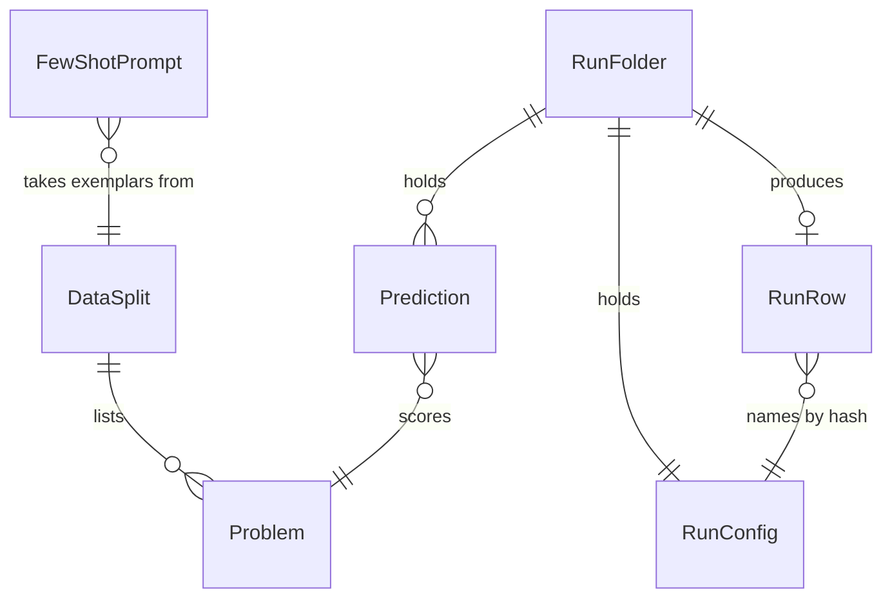

# Functional Specification: u1-eval-skeleton

The walking skeleton (`inception/units-generation/unit-of-work.md`, U1). It implements US1.1, US1.2, US1.3 and US1.4 of `inception/user-stories/stories.md`, as assigned in `inception/units-generation/unit-of-work-story-map.md`. Requirements: FR1.1–FR1.7, NFR5 and NFR7 in `inception/requirements-analysis/requirements.md`. Building blocks: DatasetsAndPrompts, AnswerScoring, RunConfiguration, RunRecords, Evaluation and RunCommands in `inception/domain-design/components.md`. Contracts: C1, C2, the lock part of C3 (as changed 2026-10-31) and C5 in `inception/contract-design/contract-summary.md`. Entities are in `entities.md`, rules in `rules.md`.

This file is the source of truth for the workflows and state machines. The entity diagram and the rules summary below are derived views.

## Workflows

### W1 Load the data and the split (US1.1)

1. The command sets the six cache variables to project paths before anything else is loaded (BR1.1).
2. GSM8K `main` loads from the project cache, or downloads anonymously into it the first time (BR1.2). Each problem gets its id from its row order: `gsm8k-train-<i>`, `gsm8k-test-<i>`.
3. The split file `outputs/splits/gsm8k-split42.json` is read. The fixed split seed is 42; the training `seed` dial never changes the split.
   - **Missing:** the split is built from the split seed (BR1.3), checked (BR1.4, BR1.5) and saved atomically (BR5.4).
   - **Present but unreadable, or failing a check:** the run stops with exit code 1 and names the file (BR1.6).
4. The split is used for every later step.

### W2 Build the prompt (US1.2)

1. The four exemplars are a seeded sample of the sorted dev ids (BR2.1).
2. Each exemplar's worked answer has its `<<…>>` calculator notes removed (BR2.3).
3. The template joins the exemplars as `Question:` / `Answer:` pairs separated by blank lines, then the target `Question:` and `Answer:` (BR2.3).
4. The dev problems to score are the dev ids minus the four exemplars: 496 (BR2.2).

### W3 Score one output (US1.3)

1. The scored text is the output up to the stop point (BR3.5).
2. If a `####` number exists, it is the prediction (BR3.1). Otherwise the last number in the scored text is (BR3.2). With no number, the prediction is empty and the answer is wrong (BR3.3).
3. Commas, `$` and `%` are removed and the prediction is compared with the gold number as a decimal (BR3.4).

### W4 Run `gsm8k evaluate` (US1.4)

```
gsm8k evaluate [--config <path>] [--run-id <base id>-<n>] [--results <path>] [--started-by worker|terminal]
               [--split dev|test] [--limit N] [--model <id>] [--adapter <path>] [--seed N]
```

The worker always passes `--config` (written by the service into `outputs/<run_id>/config.json` before launch), `--run-id` and `--started-by worker` (C5). A terminal run usually gives flags instead.

1. **Set up.** Set the caches (BR1.1).
2. **Build the configuration.** With `--config`, read that file and require its `run_id` to equal `--run-id`. Without it, build the configuration from the flags and their defaults (BR4.8). Without `--run-id` the run is named `adhoc-<UTC timestamp>`.
3. **Check the input.** Each failure here exits with code 2 and writes nothing (BR5.2):
   - an unknown option or a bad value
   - a missing adapter: "Adapter not found" (BR4.6)
   - an adapter whose run cannot be read: "Adapter run unknown" (BR4.7)
   - a run id already used, meaning one with a row or a folder where a run already happened: "Run id already used" (BR5.3). A folder holding only the launcher's `config.json` does not count.

   With an adapter, the method and `adapter_run` come from the adapter's run (BR4.7). Compute `config_hash` (BR4.5).
4. **Take the lock.** Take the GPU lock (BR5.1) and record `--started-by` in the lock content. If the lock is held, exit with code 3 and "A run is already active: <run_id>", writing nothing.
5. **Prepare.** Create `outputs/<run_id>/` if needed, and write `config.json` unless it came from `--config` (C2).
6. **Generate and score.** Load the data (W1), the prompt (W2), the model in bfloat16 and, if set, the adapter. Choose the problems to score: dev minus the exemplars, or all of test, sorted by numeric index, then the first N with `--limit` (BR2.2). Generate greedily in batches of 8, up to the stop rule (BR3.5), and score every output (W3). Each prediction is appended to `predictions.jsonl` as it is scored.
7. **Finish.** Write `timings.json` with seconds per problem and peak GPU memory (BR4.4). Print accuracy, problems scored and minutes (BR4.1).
8. **Write the row.** Append one row to the results file (BR4.2, BR4.3): `data` is `gsm8k-dev` or `gsm8k-test`, `metric` is `accuracy`, and `adapter_run` is the adapter's run or empty (BR4.7).
9. **Close.** Write `status.json` with status `finished` and exit code 0 (BR5.2). The lock is released when the process ends.

**Failure paths** (BR5.2):
- An error after step 4 writes `status.json` with status `failed`, exit code 1 and the reason. A CUDA out-of-memory error is reported as "GPU out of memory". It writes timings when known and no row.
- SIGINT or SIGTERM writes `status.json` with status `stopped` and exit code 130, and no row.

## State Machines

### Run lifecycle

| Current state | Event | Guard | Next state | Actions |
|---|---|---|---|---|
| (none) | command starts | configuration valid, adapter and its run readable, run id unused | checking | read or build the config, hash |
| (none) | command starts | any check above fails | rejected | exit 2, nothing written |
| checking | take lock | lock free | running | write lock content (with `started_by`), create run folder, write `config.json` unless given |
| checking | take lock | lock held | refused | exit 3, nothing written |
| running | all problems scored | — | finished | `timings.json`, row, `status.json` (0) |
| running | error | — | failed | `status.json` (1, reason), timings if known, no row |
| running | SIGINT or SIGTERM | — | stopped | `status.json` (130), no row |

`rejected`, `refused`, `finished`, `failed` and `stopped` are terminal. The kernel releases the lock on every exit from `running`.

### GPU lock

| Current state | Event | Guard | Next state | Actions |
|---|---|---|---|---|
| free | take | — | held | holder writes `run_id`, `pid`, `started_at`, `started_by` |
| held | take by another process | — | held | the other process exits 3 |
| held | holder exits, also by crash | — | free | the kernel releases; on a clean exit the holder clears the content |

A free lock whose file still names a run means that run ended without finishing. This is reported by u4's status, not acted on here.

## Entity Relationships (derived from entities.md)



<!-- Text fallback: a DataSplit lists many Problems; the FewShotPrompt takes its exemplars from one DataSplit; each Prediction scores one Problem; a RunFolder holds one RunConfig and many Predictions and produces at most one RunRow; each RunRow names its RunConfig by hash. -->

## Rules Summary (derived from rules.md)

| Area | Rules |
|---|---|
| Data and split | BR1.1–BR1.6 |
| Prompt | BR2.1–BR2.3 |
| Scoring | BR3.1–BR3.5 |
| Evaluation and run log | BR4.1–BR4.8 |
| Lock, exit codes, run ids, atomic writes | BR5.1–BR5.4 |

## Walking Skeleton Demo

`gsm8k evaluate --limit 10 --split dev` loads the 0.6B model on the GPU and scores 10 dev problems. It prints accuracy, problems scored and minutes, writes `outputs/adhoc-<timestamp>/` (config, predictions, timings, status) and appends one row to a temporary run log whose path it prints. This proves every link in W1–W4 end to end (`inception/practices-discovery/team-practices.md`, Walking Skeleton).
