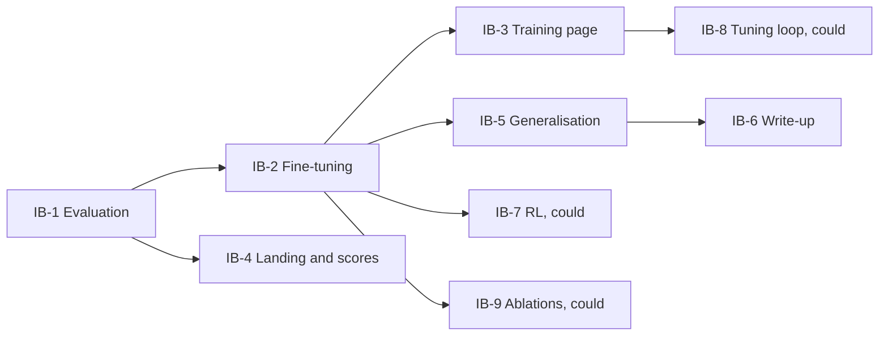

# Intent Backlog: Fine tune model for grade math

Upstream: `ideation/intent-capture/intent-statement.md`, `ideation/feasibility/feasibility-assessment.md`, `ideation/feasibility/constraint-register.md`; scope in `scope-document.md`; answers in `scope-definition-questions.md`.

Prioritisation: MoSCoW from Nico's answers (Q1–Q4), ordered by learning order (Q5) and dependencies.

## Backlog

| Order | ID | Proto-unit | MoSCoW | Depends on | What it teaches | Source |
|---|---|---|---|---|---|---|
| 1 | IB-1 | Evaluation harness: GSM8K splits with a held-out dev split, answer extraction, fixed evaluation protocol, run log, baseline scores, run-time measurement | Must | none | How a base model is evaluated; test-set hygiene | intent-statement.md; feasibility-assessment.md |
| 2 | IB-2 | Supervised fine-tuning with LoRA, driven by a run configuration (the dials), logging training metrics | Must | IB-1 | Supervised fine-tuning and LoRA | feasibility-assessment.md; Q5 |
| 3 | IB-3 | Website training page: live training curves, dials that write a run configuration, and a start button that launches a run on this PC (one at a time, survives the browser closing) | Must | IB-2 (metrics to show) | Reading training curves | Q3; constraint-register.md TC-4 |
| 4 | IB-4 | Website landing page with the halftone headline, and highest-scores page ranking runs from the run log | Must | IB-1 (run log) | (presentation) | Q3; constraint-register.md LC-3 |
| 5 | IB-5 | Generalisation check: score baseline and best model on GSM-Plus and GSM-Symbolic (evaluation only) | Must | IB-1, IB-2 | Whether gains are real | Q4; constraint-register.md LC-2 |
| 6 | IB-6 | `results.md` write-up and check questions after each step | Must | IB-1 to IB-5 | What moved the number and why | intent-statement.md |
| 7 | IB-7 | Reinforcement learning (GRPO) with a correct-answer reward, sized to fit 3 hours | Could | IB-1, IB-2, run-time measurement | Reinforcement learning from verifiable rewards | Q1; constraint-register.md TC-2 |
| 8 | IB-8 | Tuning loop: Optuna search over short proxy runs on the dev split, plus a proposer and a reviewer agent that suggest the next run's settings (Nico starts long runs) | Could | IB-2, IB-3 | Hyperparameter search | Q2; constraint-register.md OC-4 |
| 9 | IB-9 | Ablations (terse versus step-by-step answers, samples per problem, a calculator tool) | Could | IB-2 (IB-7 for samples per problem) | What each choice changes | Q4 |

IB-5 and IB-6 run on the final model, so in time they come after any could-haves that are done (Q5).

## Dependency Overview

<!-- Text fallback: IB-1 evaluation comes first. IB-2 fine-tuning and IB-4 landing and scores depend on it. IB-3 training page, IB-5 generalisation, IB-7 reinforcement learning and IB-9 ablations depend on IB-2. IB-8 tuning loop depends on IB-3. IB-6 write-up comes after IB-5. -->

## Assumptions & Open Questions

- [assumption] IB-4's halftone headline uses the pasted 21st.dev component only if Nico confirms its licence; otherwise it is rewritten from scratch (constraint-register.md LC-3).
