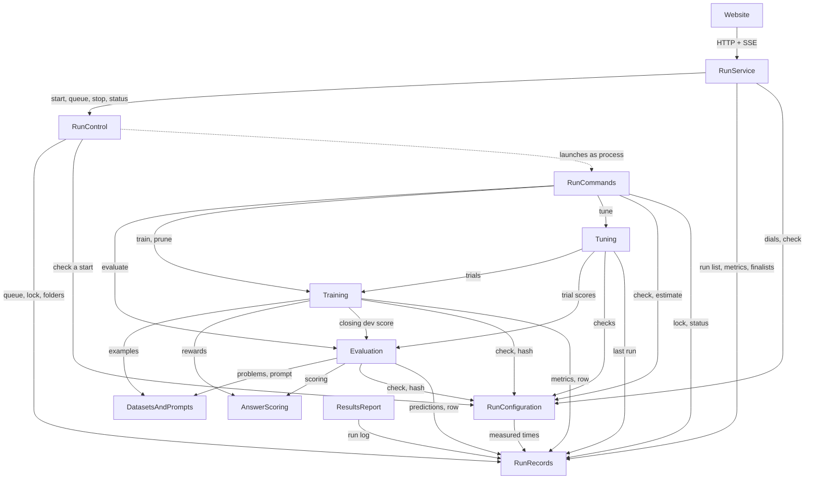

# Components: Fine tune model for grade math

The logical building blocks: code the project writes, not infrastructure. Built from `inception/requirements-analysis/requirements.md` (FR1–FR9, NFR1–NFR10; FR3.4 as changed on 2026-10-31), `inception/user-stories/stories.md` (US1.1–US9.1, including US3.7) and `inception/practices-discovery/team-practices.md` (tests first, quick tests, long runs started by Nico with `--run-id`, nothing outside the project folder). Answers: `domain-design-questions.md` Q1–Q5. Decisions: `decisions.md` (ADR-001 to ADR-008).

How these blocks group into units of work and packages is decided in Units Generation; the tech stack is already fixed by the brief (Python with Transformers, TRL and PEFT; FastAPI with Server-Sent Events; React, TypeScript, Vite, Tailwind and shadcn/ui).

```yaml
components:
  - name: DatasetsAndPrompts
    summary: Loads GSM8K and the generalisation sets, builds the fixed dev split and the fixed 4-shot prompt.
    behaviour: >
      Loads openai/gsm8k (config main), GSM-Plus testmini and GSM-Symbolic p1 from Hugging Face with no
      token, caching only under the project's .cache/. Splits the 7,473 training problems with a seed into
      500 dev and 6,973 train ids, saved as an id list and rebuilt identically from the seed when missing;
      an unreadable split file stops the run naming the file. Chooses the four prompt exemplars
      deterministically from the dev split and removes them from dev scoring (496 scored). Builds training
      targets in step-by-step or terse format. Refuses any request that would put a test-split, GSM-Plus or
      GSM-Symbolic problem into training or tuning data. GSM-Plus testmini and GSM-Symbolic p1 are pinned to a
      Hub commit hash in the code, like openai/gsm8k; GSM-Plus rows whose answer is not a plain decimal number are
      left out and counted: 307 of 2,400 at the pin, 300 critical-thinking "None" answers and 7 fractions
      (2026-11-07).
    responsibilities:
      - Dataset loading with in-folder caches
      - Fixed dev and train split by seed
      - Fixed 4-shot prompt and exemplar exclusion
      - Training targets in step-by-step and terse formats
      - Guarding training data against test and generalisation problems
    depends_on: []
    dependents:
      - component: Evaluation
        interaction: gets the problems of a split and the prompt for each
      - component: Training
        interaction: gets training examples and the dev split for the closing score
    external_dependencies:
      - name: Hugging Face Hub (public datasets)
        kind: third-party-api
        purpose: one-time download of GSM8K, GSM-Plus and GSM-Symbolic
      - name: Project cache folder (.cache/huggingface)
        kind: object-store
        purpose: local copy of downloaded datasets
    entities:
      - name: Problem
        identifier: problem_id
        attributes: [problem_id, source_set, split, question, gold_answer]
      - name: DataSplit
        identifier: seed
        attributes: [seed, dev_ids, train_ids, exemplar_ids]
      - name: FewShotPrompt
        identifier: prompt_version
        attributes: [prompt_version, exemplar_ids, template]
        references:
          - entity: DataSplit
            owned_by: DatasetsAndPrompts
            relationship: the exemplars are taken from one dev split

  - name: AnswerScoring
    summary: Turns a model's text into a final number and judges it against the gold answer.
    behaviour: >
      Extracts the number after "####", else the last number in the output; strips commas and currency
      signs and compares numerically, so 72.0 equals 72. An output with no number is wrong, never an error.
      Also provides the GRPO rewards: correctness 1 or 0, and a format reward only when a "#### <number>"
      line is present; and majority voting over several sampled answers (ties to the earliest, numberless
      samples ignored). Pure functions with no I/O.
    responsibilities:
      - Final-number extraction and numeric comparison
      - Correctness and format rewards
      - Majority vote over samples
    depends_on: []
    dependents:
      - component: Evaluation
        interaction: scores each prediction
      - component: Training
        interaction: computes GRPO rewards
    external_dependencies: []
    entities: []

  - name: RunRecords
    summary: The only code that reads or writes the run log, the finalists file, the run folders, the lock file and the queue files.
    behaviour: >
      Appends exactly one row per scored run to results/runs.csv (date, run_id, model, method, data, metric,
      value, minutes, config_hash), or to a temporary path when no run id is given or a test points it
      there. Parses the log skipping and counting malformed rows; a missing log is an empty list, an
      unreadable one an error naming the file. Owns attempt numbering: the next attempt of a base id is one
      more than the highest attempt found in the log, in outputs/ and in the queue, and an attempt id that
      already exists is refused naming it. Writes and reads each run's folder under outputs/<run_id>/
      (config, metrics.jsonl appended line by line, predictions, log, seconds per step or problem, peak GPU
      memory, final status), returning only complete metrics lines. Keeps results/finalists.json. Creates the
      lock file atomically (create-if-absent) with run id and process id, so of two racing starts exactly one
      wins. Stores the queue as one file per waiting run under outputs/queue/ with its position. Every write
      is write-then-rename so a crash never leaves a half file.
    responsibilities:
      - Run log rows and their parsing
      - Attempt numbering and duplicate run-id refusal
      - Run folders and their files
      - Finalist marks
      - Lock file and queue files, created atomically
    depends_on: []
    dependents:
      - component: RunConfiguration
        interaction: reads measured times and the last run's config for estimates and change summaries
      - component: Evaluation
        interaction: writes predictions, timings and the result row
      - component: Training
        interaction: writes metrics lines, timings, peak memory and the result row; reads best and finalist runs for pruning
      - component: RunCommands
        interaction: takes and releases the lock for terminal and worker runs
      - component: RunControl
        interaction: reads and writes the queue, reads the lock and run folders for status
      - component: RunService
        interaction: reads the run list, metrics lines and finalists; writes finalist marks
      - component: ResultsReport
        interaction: reads the run log for the write-up
      - component: Tuning
        interaction: records trial outcomes as runs and reads the last run for the one-change rule
    external_dependencies:
      - name: Local filesystem (results/, outputs/)
        kind: object-store
        purpose: committed run log and finalists; gitignored run folders, lock and queue
    entities:
      - name: RunRow
        identifier: run_id
        attributes: [run_id, date, model, method, data, metric, value, minutes, config_hash]
        references:
          - entity: RunConfig
            owned_by: RunConfiguration
            relationship: each row records the hash of the configuration it ran with
      - name: RunFolder
        identifier: run_id
        attributes: [run_id, config, metrics_lines, predictions, log, seconds_per_unit, peak_gpu_memory_gb, final_status]
      - name: FinalistMark
        identifier: run_id
        attributes: [run_id, marked_at]
        references:
          - entity: RunRow
            owned_by: RunRecords
            relationship: a finalist is a run that has a dev score row
      - name: RunLock
        identifier: lock_path
        attributes: [run_id, process_id, started_at, started_by]
      - name: QueueEntry
        identifier: attempt_id
        attributes: [attempt_id, position, config, added_at]
        references:
          - entity: RunConfig
            owned_by: RunConfiguration
            relationship: each waiting run carries one checked configuration

  - name: RunConfiguration
    summary: The dial table, the configuration check, the configuration hash and the duration estimate.
    behaviour: >
      Holds the eleven dials with their allowed ranges and defaults (stories.md Training Dials), plus method,
      split and an optional adapter path. Fills defaults, rejects out-of-range, unknown or mistyped values
      with the dial and its allowed range, and rejects the test split for training or tuning. Computes a
      stable config_hash from the normalised configuration. Estimates duration from measured seconds per step
      or per problem for that model (training steps or problems times the measured time), reports "No
      estimate yet" when none is measured, and flags an estimate above 3 hours. Lists the dials that changed
      against the last run.
    responsibilities:
      - Dial table, defaults and validation
      - Test-split guard for training and tuning
      - Configuration hash
      - Duration estimate and 3-hour flag
      - Change summary against the last run
    depends_on:
      - component: RunRecords
        interaction: reads measured times and the last run's configuration
        style: sync
    dependents:
      - component: Evaluation
        interaction: checks the evaluation configuration and gets its hash
      - component: Training
        interaction: checks the training configuration and gets its hash
      - component: RunCommands
        interaction: checks a terminal run's configuration and prints its estimate
      - component: RunControl
        interaction: checks a website start and builds its summary
      - component: RunService
        interaction: serves the dial table and the check step
      - component: Tuning
        interaction: checks sampled trial configurations and proposals
    external_dependencies: []
    entities:
      - name: RunConfig
        identifier: config_hash
        attributes: [model, method, learning_rate, epochs, lora_rank, lora_alpha, max_seq_len, train_examples, batch_size, warmup_ratio, seed, answer_format, split, adapter_path]
      - name: DialRule
        identifier: dial_name
        attributes: [dial_name, allowed, default]

  - name: Evaluation
    summary: Scores a base model, or a base model plus an adapter, on a named split and records the result.
    behaviour: >
      Generates greedily with up to 512 new tokens on dev (496 scored), test, GSM-Plus testmini or
      GSM-Symbolic p1, with an optional problem limit and optional majority vote or calculator tool. Reports
      accuracy, number scored and minutes; writes per-problem predictions, seconds per problem and peak GPU
      memory to the run folder and one row to the run log. A missing adapter path stops it before any row.
      Also wraps the lm-evaluation-harness gsm8k task (5-shot, flexible extract, test split) as a
      cross-check that writes its own row. Never decides whether it may use the GPU: callers hold the lock.
    responsibilities:
      - Greedy evaluation on a named split
      - Optional majority vote and calculator tool
      - lm-evaluation-harness cross-check
      - Recording predictions, timings and the result row
    depends_on:
      - component: DatasetsAndPrompts
        interaction: gets problems and prompts
        style: sync
      - component: AnswerScoring
        interaction: scores each output
        style: sync
      - component: RunConfiguration
        interaction: checks the configuration and gets its hash
        style: sync
      - component: RunRecords
        interaction: writes predictions, timings and the row
        style: sync
    dependents:
      - component: Training
        interaction: scores the trained adapter on dev at the end of a run
      - component: RunCommands
        interaction: runs an evaluation from the terminal or the worker
      - component: Tuning
        interaction: scores each trial on dev
    external_dependencies:
      - name: Hugging Face Hub (public models)
        kind: third-party-api
        purpose: one-time download of Qwen3-0.6B-Base and Qwen3-1.7B-Base
      - name: GPU (RTX 3060 Ti, 8 GB)
        kind: other
        purpose: generation
      - name: lm-evaluation-harness
        kind: other
        purpose: the cross-check task

  - name: Training
    summary: Fine-tunes a base model with LoRA, by supervised fine-tuning or GRPO, behind one shared run loop.
    behaviour: >
      Two methods, sft and grpo, share one run loop that checks the configuration, appends one metrics line
      per logging step (step, total steps, loss, learning rate, elapsed and remaining seconds; plus reward,
      KL and answer length for grpo; plus dev accuracy when it evaluates), records seconds per step and peak
      GPU memory, saves the adapter under checkpoints/<run_id>/, scores it on dev through Evaluation and
      appends the run's row. GRPO starts from the base model or a named supervised adapter (a missing path
      stops it naming the path) and uses AnswerScoring's rewards. Pruning keeps each model's best run (highest
      dev accuracy, ties to the earlier run) and every finalist, lists what it would delete without --yes,
      and skips runs whose adapter is already gone.
    responsibilities:
      - Shared training loop with metrics streaming
      - Supervised fine-tuning method
      - GRPO method (could-have)
      - Adapter checkpoints and pruning
    depends_on:
      - component: DatasetsAndPrompts
        interaction: gets training examples in the chosen answer format
        style: sync
      - component: AnswerScoring
        interaction: GRPO rewards
        style: sync
      - component: RunConfiguration
        interaction: checks the configuration and gets its hash
        style: sync
      - component: Evaluation
        interaction: closing dev score of the adapter
        style: sync
      - component: RunRecords
        interaction: metrics lines, timings, row, best and finalist runs
        style: sync
    dependents:
      - component: RunCommands
        interaction: runs a training or prune command from the terminal or the worker
      - component: Tuning
        interaction: trains each short proxy trial
    external_dependencies:
      - name: Hugging Face Hub (public models)
        kind: third-party-api
        purpose: one-time download of the base models
      - name: GPU (RTX 3060 Ti, 8 GB)
        kind: other
        purpose: training
      - name: Checkpoint folder (checkpoints/)
        kind: object-store
        purpose: saved LoRA adapters, gitignored
    entities:
      - name: AdapterCheckpoint
        identifier: run_id
        attributes: [run_id, path, base_model, method]
        references:
          - entity: RunRow
            owned_by: RunRecords
            relationship: each adapter belongs to the run that trained it

  - name: RunCommands
    summary: The command-line entry points for every GPU run, used both by command-line runs (started detached by the /build lead) and by the worker.
    behaviour: >
      Each command (evaluate, train, tune, prune) sets the in-folder cache variables before any other import,
      parses --run-id and the configuration, checks it, prints the estimate and the 3-hour flag, takes the
      lock atomically through RunRecords, runs the work, writes the final status and always releases the
      lock, also on error or stop. When the lock is held it exits with "A run is already active" and the
      active run id without touching the GPU. Builds no shell command lines; arguments are passed as a list.
    responsibilities:
      - Terminal and worker entry points for evaluate, train, tune and prune
      - Lock take and release around every GPU run
      - Final status and exit reason
    depends_on:
      - component: Evaluation
        interaction: runs evaluations
        style: sync
      - component: Training
        interaction: runs training and pruning
        style: sync
      - component: Tuning
        interaction: runs the Optuna study
        style: sync
      - component: RunConfiguration
        interaction: checks the configuration and estimates its time
        style: sync
      - component: RunRecords
        interaction: takes and releases the lock, writes the final status
        style: sync
    dependents:
      - component: RunControl
        interaction: the worker launches these commands as separate processes
    external_dependencies: []
    entities: []

  - name: RunControl
    summary: The run queue, the worker that starts queued runs, stopping, and the run status.
    behaviour: >
      Adds a checked website start to a first-in, first-out queue of at most 10 waiting runs (refused with
      "The queue is full (10 waiting)"), and removes a waiting run on request. A worker loop starts the oldest
      waiting run as a separate RunCommands process when the lock is free, waiting while a command-line run holds
      it; runs keep going if the browser or the service closes. Stop ends the active process, marks it
      STOPPED and appends no row. Status is IDLE, RUNNING, STOPPED or FAILED; the lock is the C3 flock OS lock
      on outputs/run.lock, released by the kernel when its process ends, so a lock file that names a run while
      the lock is free means that run is shown FAILED with "The run process ended without finishing"; a failed run's
      reason comes from its log ("GPU out of memory" for CUDA out-of-memory). Only test-split evaluations of
      finalists, with a second confirmation, may be queued. Never imports training or evaluation code.
    responsibilities:
      - Run queue and its rules
      - Worker loop launching queued runs
      - Stop
      - Status, runs that ended without finishing (C3 flock lock) and failure reasons
      - Finalist-only test-split rule
    depends_on:
      - component: RunRecords
        interaction: queue files, lock, run folders and finalists
        style: sync
      - component: RunConfiguration
        interaction: checks a start and builds its summary
        style: sync
      - component: RunCommands
        interaction: launches queued runs as separate processes
        style: async
    dependents:
      - component: RunService
        interaction: start, queue, remove, stop and status requests
    external_dependencies:
      - name: Operating system processes
        kind: other
        purpose: launching, signalling and checking run processes
    entities: []

  - name: RunService
    summary: The local HTTP API and the live metrics stream the website uses.
    behaviour: >
      Listens on 127.0.0.1 only and has no accounts. Serves the run list (with the count of skipped rows),
      the status, the dial table, the queue, the finalists and a run's metrics. The start endpoint is two
      steps: check returns the attempt id, model, method, changes, estimate, exact command and queue position
      and starts nothing; confirm queues the checked run. Marks and unmarks finalists. Streams new complete
      metrics lines of the active run over Server-Sent Events as they are written (a missing metrics file is
      an empty stream) and resumes the stream after a restart. Errors name the file or the dial.
    responsibilities:
      - Run list, status, queue and finalist endpoints
      - Two-step start endpoint
      - Live metrics stream
    depends_on:
      - component: RunControl
        interaction: start, queue, remove, stop and status
        style: sync
      - component: RunRecords
        interaction: run list, metrics lines, finalists
        style: sync
      - component: RunConfiguration
        interaction: dial table and the check step
        style: sync
    dependents:
      - component: Website
        interaction: every page's data and the live stream
    external_dependencies:
      - name: Localhost HTTP server (127.0.0.1)
        kind: other
        purpose: serves the API and the event stream to the browser
    entities: []

  - name: Website
    summary: The three local pages (landing, highest scores, training) and their dialogs.
    behaviour: >
      Reads everything from RunService only. Landing shows the gsm8k halftone headline and the best run so
      far; Scores ranks runs by dev accuracy with baselines always shown, filters, compare, finalist marks and
      the test-split dialog; Training shows the hourglass progress band, live curves, the dials, the confirm
      and stop dialogs, the queued runs and past runs. Every page has empty, loading and error states and
      works by keyboard; motion stops under reduce-motion (refined-mockups).
    responsibilities:
      - Landing, Scores and Training pages
      - Dialogs and live updates
      - Accessibility basics
    depends_on:
      - component: RunService
        interaction: HTTP requests for data and actions; Server-Sent Events for live metrics
        style: sync
    dependents: []
    external_dependencies:
      - name: Desktop browser on this PC
        kind: other
        purpose: runs the pages
    entities: []

  - name: ResultsReport
    summary: Builds the generated parts of results.md from the run log.
    behaviour: >
      Writes the run table, the baseline and best test accuracy, the gain labelled "within noise" below about
      3 points and "outside noise" above it, the generalisation rows, and the harness numbers labelled as a
      cross-check that never enters the gain. Leaves the hand-written sections (what moved the number and
      why, what to try next) to Nico and the lead.
    responsibilities:
      - Generated sections of results.md
      - Noise label on the gain
    depends_on:
      - component: RunRecords
        interaction: reads the run log
        style: sync
    dependents: []
    external_dependencies: []
    entities: []

  - name: Tuning
    summary: The Optuna proxy study and the rule checker for proposed runs (could-haves).
    behaviour: >
      Runs short proxy trials on the 0.6B model with 100–200 training problems, scored on dev only, each
      stopped and marked pruned past 10 minutes; trials are stored in a local SQLite file under outputs/ and a
      restarted study carries on. A sampled configuration that fails the check is recorded as invalid and the
      study goes on. A study naming the test split is refused. The rule checker accepts a proposed
      configuration with a written reason only if it passes the check, uses dev only, fits the 8 GB and
      3-hour estimates and changes one main dial from the last run, and otherwise names each broken rule. It
      never starts a run.
    responsibilities:
      - Optuna proxy study
      - Proposal rule checker
    depends_on:
      - component: RunConfiguration
        interaction: checks trial and proposal configurations and their estimates
        style: sync
      - component: Training
        interaction: trains each trial
        style: sync
      - component: Evaluation
        interaction: scores each trial on dev
        style: sync
      - component: RunRecords
        interaction: last run's configuration and trial outcomes
        style: sync
    dependents:
      - component: RunCommands
        interaction: the tune command runs the study under the lock
    external_dependencies:
      - name: Optuna with a local SQLite file
        kind: database
        purpose: trial storage under outputs/
    entities:
      - name: TuningTrial
        identifier: trial_number
        attributes: [trial_number, params, dev_accuracy, state, minutes]
        references:
          - entity: RunConfig
            owned_by: RunConfiguration
            relationship: each trial runs one checked configuration
      - name: RunProposal
        identifier: proposal_id
        attributes: [proposal_id, config, reason, verdict, broken_rules]
        references:
          - entity: RunConfig
            owned_by: RunConfiguration
            relationship: each proposal names one configuration
  - name: SelfTaughtCoT                     # added 2026-11-08 (US10.1)
    summary: Samples the base model's own step-by-step solutions to training problems and keeps the correct ones.
    behaviour: >
      For the first cot_problems problems of the training part (never dev, test, GSM-Plus or GSM-Symbolic),
      builds the fixed 4-shot prompt, samples cot_samples solutions at cot_temperature with the run's seed in
      problem batches small enough for 8 GB, cuts each at the BR3.5 stop point and scores it with AnswerScoring.
      Keeps, per problem, the first correct sample with at least one reasoning line; writes cot_data.jsonl and
      cot_stats.json (C2), metrics progress lines, and one cotgen row (C1). Self-taught training (method selfcot)
      is the Training block's supervised loop reading cot_data.jsonl instead of GSM8K's reference solutions.
    responsibilities:
      - Sampling several solutions per training problem
      - The keep rule and the generation figures
    depends_on:
      - component: DatasetsAndPrompts
        interaction: training problems, the split guard and the 4-shot prompt
        style: sync
      - component: AnswerScoring
        interaction: scores each sample
        style: sync
      - component: Evaluation
        interaction: model loading and the stop rule
        style: sync
      - component: RunConfiguration
        interaction: checks the chain-of-thought dials, hashes the configuration
        style: sync
      - component: RunRecords
        interaction: run folder files, the lock and the row
        style: sync
    dependents:
      - component: RunCommands
        interaction: gsm8k cot-generate runs it under the lock
      - component: Training
        interaction: selfcot reads its cot_data.jsonl
  - name: ReasoningReport                   # added 2026-11-08 (US10.3)
    summary: Compares the latest base, sft and selfcot dev runs of a model for the Reasoning page.
    behaviour: >
      Reads the run log, the three runs' predictions.jsonl and the selfcot run's generation figures through
      RunRecords, and returns accuracy with interval, gain with noise label, flips against base, answer length,
      examples and summary sentences (C6 Reasoning). An unreadable file nulls only its part and names the file.
    responsibilities:
      - The reasoning comparison behind GET /api/v1/reasoning
    depends_on:
      - component: RunRecords
        interaction: run log rows and run folder files
        style: sync
    dependents:
      - component: RunService
        interaction: serves the comparison at /api/v1/reasoning
```

## Component Diagram



<!-- Text fallback: the Website calls only the RunService. The RunService calls RunControl, RunRecords and RunConfiguration. RunControl uses RunRecords and RunConfiguration and launches RunCommands as separate processes (dashed edge). RunCommands calls Evaluation, Training, Tuning, RunConfiguration and RunRecords. Tuning calls Training, Evaluation, RunConfiguration and RunRecords. Training calls DatasetsAndPrompts, AnswerScoring, Evaluation, RunConfiguration and RunRecords. Evaluation calls DatasetsAndPrompts, AnswerScoring, RunConfiguration and RunRecords. RunConfiguration reads RunRecords. ResultsReport reads RunRecords. RunRecords, DatasetsAndPrompts and AnswerScoring call nothing. The graph has no cycles. -->

## Component Summary

| Component | Purpose | Depends On | Dependents | Entities Owned |
|---|---|---|---|---|
| DatasetsAndPrompts | Datasets, fixed split, 4-shot prompt, training targets | — | Evaluation, Training | Problem, DataSplit, FewShotPrompt |
| AnswerScoring | Final-number scoring, rewards, majority vote | — | Evaluation, Training | — |
| RunRecords | Only reader and writer of run log, finalists, run folders, lock and queue files | — | RunConfiguration, Evaluation, Training, RunCommands, RunControl, RunService, ResultsReport, Tuning | RunRow, RunFolder, FinalistMark, RunLock, QueueEntry |
| RunConfiguration | Dials, checks, hash, estimate, change summary | RunRecords | Evaluation, Training, RunCommands, RunControl, RunService, Tuning | RunConfig, DialRule |
| Evaluation | Scores a model on a split; harness cross-check | DatasetsAndPrompts, AnswerScoring, RunConfiguration, RunRecords | Training, RunCommands, Tuning | — |
| Training | LoRA SFT and GRPO behind one loop; adapters and pruning | DatasetsAndPrompts, AnswerScoring, RunConfiguration, Evaluation, RunRecords | RunCommands, Tuning | AdapterCheckpoint |
| RunCommands | Terminal and worker entry points under the lock | Evaluation, Training, Tuning, RunConfiguration, RunRecords | RunControl | — |
| RunControl | Queue, worker, stop, status | RunRecords, RunConfiguration, RunCommands (as processes) | RunService | — |
| RunService | Local HTTP API and live stream | RunControl, RunRecords, RunConfiguration | Website | — |
| Website | Three pages and dialogs | RunService | — | — |
| ResultsReport | Generated parts of results.md | RunRecords | — | — |
| Tuning | Optuna study and proposal rule checker (could-have) | RunConfiguration, Training, Evaluation, RunRecords | RunCommands | TuningTrial, RunProposal |
| SelfTaughtCoT | Own-solution sampling and the keep rule (could-have, added 2026-11-08) | DatasetsAndPrompts, AnswerScoring, Evaluation, RunConfiguration, RunRecords | RunCommands, Training | — |
| ReasoningReport | Base, sft and selfcot comparison for the Reasoning page (added 2026-11-08) | RunRecords | RunService | — |
| FinetuneLab | Lab lessons, CPU training loop of the small model and the lab files of C8 (could-have, added 2026-11-08) | DatasetsAndPrompts, AnswerScoring, Evaluation | RunService (launches `gsm8k lab run` as a process) | — |

## Entity Ownership

| Entity | Owning Component | Identifier | Attributes | References |
|---|---|---|---|---|
| Problem | DatasetsAndPrompts | problem_id | problem_id, source_set, split, question, gold_answer | — |
| DataSplit | DatasetsAndPrompts | seed | seed, dev_ids, train_ids, exemplar_ids | — |
| FewShotPrompt | DatasetsAndPrompts | prompt_version | prompt_version, exemplar_ids, template | DataSplit |
| RunRow | RunRecords | run_id | run_id, date, model, method, data, metric, value, minutes, config_hash | RunConfig |
| RunFolder | RunRecords | run_id | run_id, config, metrics_lines, predictions, log, seconds_per_unit, peak_gpu_memory_gb, final_status | — |
| FinalistMark | RunRecords | run_id | run_id, marked_at | RunRow |
| RunLock | RunRecords | lock_path | run_id, process_id, started_at, started_by | — |
| QueueEntry | RunRecords | attempt_id | attempt_id, position, config, added_at | RunConfig |
| RunConfig | RunConfiguration | config_hash | model, method, eleven dials, split, adapter_path | — |
| DialRule | RunConfiguration | dial_name | dial_name, allowed, default | — |
| AdapterCheckpoint | Training | run_id | run_id, path, base_model, method | RunRow |
| TuningTrial | Tuning | trial_number | trial_number, params, dev_accuracy, state, minutes | RunConfig |
| RunProposal | Tuning | proposal_id | proposal_id, config, reason, verdict, broken_rules | RunConfig |

## External Dependencies

| Component | Dependency | Kind | Purpose |
|---|---|---|---|
| DatasetsAndPrompts | Hugging Face Hub (public datasets) | third-party-api | One-time dataset download, no token |
| DatasetsAndPrompts | `.cache/huggingface` | object-store | Local dataset cache inside the project |
| RunRecords | `results/`, `outputs/` | object-store | Run log and finalists (committed); run folders, lock, queue (gitignored) |
| Evaluation | Hugging Face Hub (public models) | third-party-api | One-time model download |
| Evaluation | GPU (RTX 3060 Ti, 8 GB) | other | Generation |
| Evaluation | lm-evaluation-harness | other | Cross-check task |
| Training | Hugging Face Hub (public models) | third-party-api | One-time model download |
| Training | GPU (RTX 3060 Ti, 8 GB) | other | Training |
| Training | `checkpoints/` | object-store | Saved adapters, gitignored |
| RunControl | Operating system processes | other | Launch, signal and check run processes |
| RunService | Localhost HTTP server | other | API and event stream on 127.0.0.1 |
| Website | Desktop browser on this PC | other | Runs the pages |
| Tuning | Optuna with local SQLite | database | Trial storage under `outputs/` |

## Rationale

| Component | Why it is a separate building block |
|---|---|
| DatasetsAndPrompts | Distinct concern and data: the fixed split and prompt must never change between runs (NFR7), and the test-split guard lives with the data (NFR8) |
| AnswerScoring | Pure logic with its own change rate; the same rules serve evaluation, GRPO rewards and majority vote, so the score means the same thing everywhere |
| RunRecords | Distinct data ownership (Q2): one place for the column format, the malformed-row rule, attempt numbering and atomic lock and queue writes (ADR-002) |
| RunConfiguration | The dial table changes on its own (inception/changes.md) and is used by every run path; estimates sit here to keep the graph acyclic (ADR-007) |
| Evaluation | Distinct lifecycle: the walking skeleton (US1.4) and every scored number; reused by Training and Tuning |
| Training | Distinct concern and heaviest dependencies (Transformers, TRL, PEFT); one block for SFT and GRPO because they share the run loop (ADR-005) |
| RunCommands | Lets the service and the queue never import ML code (Q3) while terminal and worker runs behave the same (ADR-006) |
| RunControl | Distinct lifecycle: a long-lived worker and queue policy, separate from request handling (ADR-003, ADR-004) |
| RunService | The only network surface; kept thin so its security rules (localhost, no free-form commands) are in one place (ADR-008) |
| Website | Different language and toolchain (TypeScript, Node under `.tools/node/`); talks only to RunService (ADR-008) |
| ResultsReport | Distinct output and change rate: runs once at the end, reads only the log |
| Tuning | Could-have with its own dependency (Optuna); kept apart so the must-haves never wait on it |

**Alternatives rejected** (details in `decisions.md`): a coarse 3-block split (ML core, service, website) and a fine 15-block split by story group (ADR-001); direct file access from every block (ADR-002); launching runs straight from the service or in a service thread (ADR-003); two training blocks (ADR-005); keeping the entry points inside RunControl (ADR-006).

**Departure from the confirmed list:** Q1 listed ten Python blocks; this catalogue has eleven. RunCommands was added so that RunControl and RunService never import training code (Q3) without creating a dependency cycle, and the lock and queue files moved under RunRecords because Q2 gave it every file under `outputs/` (ADR-002, ADR-006).
