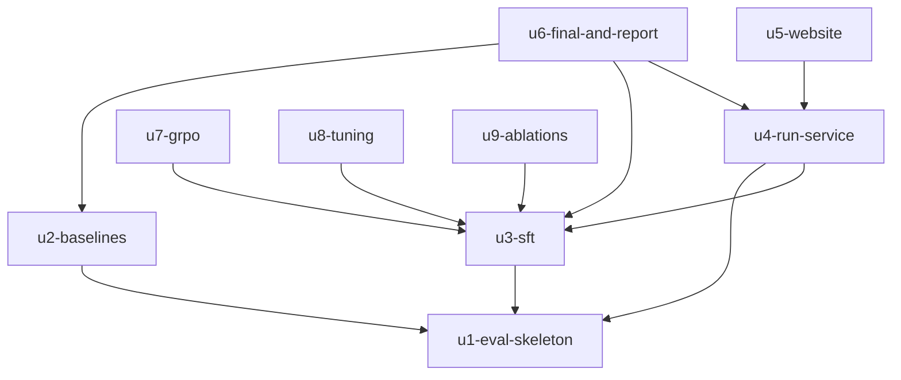

# Unit Dependencies

The dependency graph between the units in `unit-of-work.md`. It follows the building-block dependencies in `inception/domain-design/components.md` and the decisions in `inception/domain-design/decisions.md`, with the stories of `inception/user-stories/stories.md` and the requirements of `inception/requirements-analysis/requirements.md`. This file describes what can depend on what; the build batches are formed by `/build`: every unit whose dependencies are built goes in the next batch (inception/changes.md, 2026-10-31).

## Dependency Graph

```yaml
units:
  - name: u1-eval-skeleton
    kind: library
    depends_on: []
  - name: u2-baselines
    kind: library
    depends_on: [u1-eval-skeleton]
  - name: u3-sft
    kind: library
    depends_on: [u1-eval-skeleton]
  - name: u4-run-service
    kind: service
    depends_on: [u1-eval-skeleton, u3-sft]
  - name: u5-website
    kind: ui
    depends_on: [u4-run-service]
  - name: u6-final-and-report
    kind: library
    depends_on: [u2-baselines, u3-sft, u4-run-service]
```

Deferred (Nico, 2026-11-07): u7-grpo, u8-tuning and u9-ablations are out of the `units:` block above and not built in this build. Each depends on u3-sft (kind library); the graph and table below still show them for when they come back.



<!-- Text fallback: arrows point from a unit to what it depends on. u1-eval-skeleton depends on nothing. u2-baselines and u3-sft depend on u1-eval-skeleton. u4-run-service depends on u1-eval-skeleton and u3-sft. u5-website depends on u4-run-service. u6-final-and-report depends on u2-baselines, u3-sft and u4-run-service. u7-grpo, u8-tuning and u9-ablations each depend on u3-sft. There are no cycles. -->

## Edges and Why

| Unit | Depends on | Why |
|---|---|---|
| u2-baselines | u1-eval-skeleton | The harness wrapper and the baseline runs use the evaluate command, the run log and the lock |
| u3-sft | u1-eval-skeleton | Training reuses data, scoring, run records, the configuration hash and the closing dev evaluation |
| u4-run-service | u1-eval-skeleton | The worker launches the evaluate command; the service reads the run log through RunRecords |
| u4-run-service | u3-sft | The check step serves the full dial table and estimates; the worker launches the train command |
| u5-website | u4-run-service | Every page reads from and acts through the run service (ADR-008) |
| u6-final-and-report | u2-baselines | The final harness cross-check uses u2's wrapper; the gain is measured against u2's baseline rows |
| u6-final-and-report | u3-sft | The final test score is of a trained adapter |
| u6-final-and-report | u4-run-service | Only finalists are scored on test, and finalists are marked through the service (FR3.6) |
| u7-grpo | u3-sft | GRPO is a second method of u3's training loop and can start from a supervised adapter |
| u8-tuning | u3-sft | Trials train and score through u3's training loop and dial table |
| u9-ablations | u3-sft | The terse-format ablation is a fine-tune; vote and calculator compare against u3's runs |

## Integration Points

| Between | Integration | Shape |
|---|---|---|
| u1 and every later Python unit | RunRecords files: `results/runs.csv` rows, `outputs/<run_id>/` folders, the lock file | Shared on-disk formats owned by RunRecords (ADR-002); the contracts are pinned in Contract Design |
| u1 and every later Python unit | `gsm8k` subpackage APIs: DatasetsAndPrompts, AnswerScoring, RunConfiguration, Evaluation | In-process Python calls |
| u3 and u4 | `gsm8k train` and `gsm8k evaluate` commands launched by the worker | Separate processes with list arguments (ADR-003, ADR-006) |
| u4 and u5 | HTTP JSON API and Server-Sent Events on 127.0.0.1 | Network calls on this PC only (ADR-008) |
| u4 and u6 | `results/finalists.json` through RunRecords | Shared file |

## Parallel Development Opportunities

Units with no path between them are built at the same time, in one batch by parallel builders (`/build`, CLAUDE.md; inception/changes.md, 2026-10-31):

- `u2-baselines` and `u3-sft`, once `u1-eval-skeleton` is done.
- `u7-grpo`, `u8-tuning` and `u9-ablations` with each other, once `u3-sft` is done, and with `u4-run-service`, `u5-website` and `u6-final-and-report`.
- `u2-baselines` with `u4-run-service` and `u5-website`.
- The long runs (`u2-baselines`, and later `u3-sft`'s two runs), started detached by the `/build` lead or by Nico from the website, can run on the GPU while the next batch's code is written, since writing code and the CPU-only tests do not need the GPU.

## Walking Skeleton

`u1-eval-skeleton` is the only unit with no dependencies, so it is first in every valid order. It is the smallest integrated slice that runs on its own:

- it loads GSM8K into the project cache
- builds the fixed 4-shot prompt
- runs `Qwen/Qwen3-0.6B-Base` greedily on the CPU over 3 dev problems, up to 256 new tokens
- scores the final numbers
- writes one row to a temporary run log, under the lock

This exercises the Python environment, in-folder caches, model download, scoring and the run log end to end (team-practices.md, Walking Skeleton), as a quick test on the CPU (NFR3). GPU use is first proven by the first detached long run, the 0.6B baseline evaluation (AC1.5.1). The `/build` lead sets the verification command from the spec.
